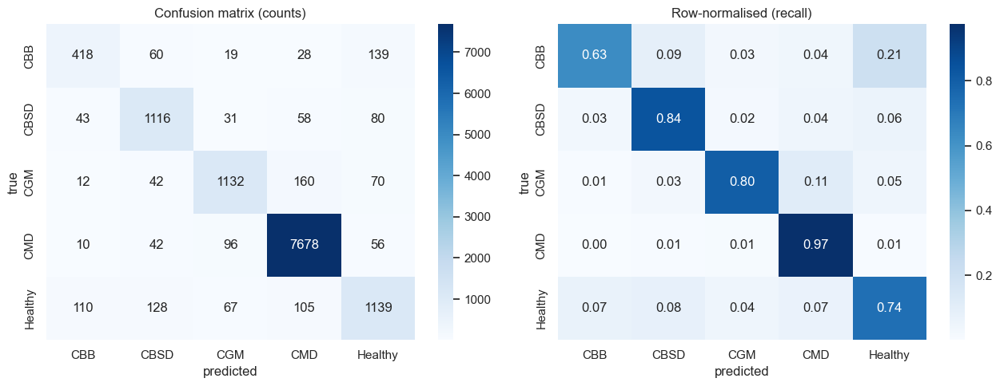

# Cassava Leaf Disease Classification

A complete, reproducible pipeline that classifies a photo of a cassava leaf into one of five classes (four diseases + healthy), trained with cross-validation on the Kaggle *Cassava Leaf Disease Classification* data. This document is the single, final reference: what the project is, every step that was run, every file, every setting, and every number produced.

**Headline result: out-of-fold (OOF) accuracy 0.8944 on 12,839 held-out images** (majority-class baseline 0.614), from a ConvNeXt-Tiny trained at 384 px, 3-fold training (folds 0-2 of a 5-way split), 6 epochs each, with a 3-model x 4-view test-time-augmentation ensemble for inference.

---

## 1. Goal and use

Cassava is a staple food crop in sub-Saharan Africa and its leaf diseases cause large yield losses. Diagnosis normally needs an expert visit. The goal is a model that takes a phone photo of a leaf and predicts the disease class, so that farmers and extension workers can diagnose in the field.

This project produces:
- cross-validated models and an honest accuracy estimate (OOF),
- an ensemble inference path that writes `submission.csv` (`image_id,label`) in the Kaggle submission format,
- an analysis notebook (`notebooks/Cassava.ipynb`) with EDA, training summary, error analysis and inference.

### Classes

| Label | Short | Class | Images | Share |
|---|---|---|---|---|
| 0 | CBB | Cassava Bacterial Blight | 1,087 | 5.1% |
| 1 | CBSD | Cassava Brown Streak Disease | 2,189 | 10.2% |
| 2 | CGM | Cassava Green Mottle | 2,386 | 11.2% |
| 3 | CMD | Cassava Mosaic Disease | 13,158 | 61.5% |
| 4 | Healthy | Healthy | 2,577 | 12.0% |
| | | **Total** | **21,397** | 100% |

Class imbalance (majority/minority) is **12.1x**. Always predicting CMD already gives 61.5% accuracy, so raw accuracy must be read against that baseline, and per-class recall matters (see Results).

---

## 2. Tech stack and environment

| Item | Value |
|---|---|
| OS / hardware | Windows 11, NVIDIA GeForce RTX 4060 Laptop GPU (8 GB) |
| Python | 3.10 (`C:\Users\super\AppData\Local\Programs\Python\Python310\python.exe`). The default `python` on PATH lacks `cv2`, so always use this interpreter |
| Deep learning | PyTorch 2.5.1 (CUDA 12.1), torchvision 0.20.1, `timm` 1.0.30 |
| Precision / speed | fp16 autocast (`torch.autocast` + `GradScaler`), `channels_last` memory format |
| Augmentation | Albumentations 2.0.8 |
| Image IO | OpenCV (`opencv-python-headless` 5.0.0.93) |
| Data / metrics | NumPy 2.2.6, pandas 2.3.3, scikit-learn 1.7.2 (`StratifiedGroupKFold`, metrics) |
| Notebook / plots | nbformat 5.11.1, nbconvert 7.17.2, ipykernel 7.3.0, matplotlib 3.10.9, seaborn 0.13.2 |

All pins are in `requirements.txt` (install the CUDA build of torch as noted in that file).

---

## 3. The data

Source: Kaggle *Cassava Leaf Disease Classification* (placed in `data/`).

- **Training set:** 21,397 JPEG photos listed in `data/train.csv` (`image_id,label`), all exactly **800 x 600** (aspect ratio 1.333), so no per-image geometry handling is needed.
- **Test set:** the local `data/test_images/` contains **one** image (`2216849948.jpg`), a placeholder; the real test set is hidden on Kaggle. Because of this, model quality is judged by cross-validation (OOF), not by a test score. `data/sample_submission.csv` has the header plus that single row.
- **Other files in `data/`:** `label_num_to_disease_map.json` (label -> disease name), `train_tfrecords/` and `test_tfrecords/` (unused), and a third-party notebook `intelisys-final-inference-workbook.ipynb` (unused).

### What the EDA found

- **Imbalance:** CMD is 61.5% of data; CBB only 5.1%.
- **Per-class image statistics** (mean over images; brightness, contrast and sharpness measured on grayscale):

| Class | R | G | B | Brightness | Contrast | Sharpness (Laplacian var) |
|---|---|---|---|---|---|---|
| CBB | 102.8 | 119.0 | 68.0 | 108.3 | 53.5 | 1779.8 |
| CBSD | 106.6 | 124.9 | 73.3 | 113.6 | 51.9 | 1659.5 |
| CGM | 113.5 | 127.8 | 85.8 | 118.7 | 53.0 | 2352.8 |
| CMD | 110.3 | 127.4 | 80.9 | 117.0 | 53.7 | 2586.7 |
| Healthy | 108.8 | 126.9 | 79.9 | 116.1 | 52.4 | 2114.7 |

  Global colour/brightness/sharpness differ only slightly between classes, so the classes are not separable by simple image statistics; the model has to learn local lesion texture (the reason a high input resolution was used).
- **Duplicates / label-noise check:** a 64-bit difference hash (dhash) was computed for every image. **All 21,397 hashes are unique**: zero exact-hash duplicates and therefore zero duplicate groups with conflicting labels. (The Kaggle data is known to contain near-duplicate images, but they differ in the hash, so this exact-match check does not find them.) Consequence: grouping folds by dhash had no real effect here (see section 5.1).

---

## 4. What was done, in order

1. **Data prep (`src/prep.py`)**: resized all 21,397 training images to a 512 x 384 JPEG cache and computed per-image statistics and the dhash (`cache/features.csv`).
2. **Backbone benchmark (`src/bench.py`)**: measured training throughput on the 8 GB GPU. ConvNeXt-Tiny reached **~74 img/s** versus **16-21 img/s** for EfficientNet-B3/B4, so ConvNeXt-Tiny was chosen as the best accuracy-per-time option for this hardware.
3. **Smoke test**: a 1-epoch run (tag `smoke`, fold 0) verified the pipeline: val accuracy 0.8853 after one epoch (313 s). Its files were throwaway and have been deleted.
4. **Training (`src/train.py`)**: A 5-way split was prepared and 5-fold CV was originally planned. The run was interrupted once by a low-memory event, which left a half-trained fold-1 checkpoint; that checkpoint was deleted and training resumed (using the Python 3.10 interpreter, because another one lacked `cv2`).
5. **Decision: 3 folds, not 5.** To fit the time budget only folds 0, 1, 2 were trained, at 6 epochs and 384 px. A smaller ensemble costs an estimated ~0.1-0.3% accuracy, whereas fewer epochs or smaller images would cost more.
6. **Evaluation**: OOF probabilities from the 3 trained folds were analysed (accuracy, per-class report, confusion matrix, calibration, confident mistakes).
7. **Inference**: the 3 fold models were ensembled with 4-view test-time augmentation and wrote `submission.csv`.

Total training wall time: ~218 s/epoch on average x 6 epochs x 3 folds, about **65 minutes**.

---

## 5. Method in detail

### 5.1 Cross-validation folds
- The data is split into 5 parts, of which 3 are trained (3-fold CV). `StratifiedGroupKFold(n_splits=5, shuffle=True, random_state=42)`, stratified by label and grouped by dhash. Assignments are stored in `cache/folds.csv` and reused by every run.
- Fold sizes: 4,280 / 4,279 / 4,280 / 4,279 / 4,279 images. Each fold's model trains on the other four folds (~17,100 images) and validates on its own fold (~4,280).
- Because every dhash is unique, the grouping is effectively plain stratification and gives no duplicate-leakage protection in this data. Near-duplicate images that the exact hash misses could still straddle train/val and slightly inflate OOF accuracy.
- Only folds 0, 1, 2 were trained, so the OOF set covers **12,839 images** (4,280 + 4,279 + 4,280). Rows of folds 3 and 4 are all-zero in `oof/cnxt.npy` and are masked out (`oof.sum(1) > 0`) in all analysis.

### 5.2 Model
`convnext_tiny` from `timm`, ImageNet-pretrained, new 5-class head, stochastic depth (`drop_path_rate`) 0.1. Checkpoint size is about 106 MB per fold.

### 5.3 Input pipeline
- Images are read from the 512 x 384 cache (not the original 800 x 600) for speed.
- **Training augmentation:** RandomResizedCrop to 384 x 384 (scale 0.5-1.0), Transpose (p 0.5), HorizontalFlip (0.5), VerticalFlip (0.5), Affine rotation +/-30 degrees (0.5), HueSaturationValue (10, 15, 10; p 0.5), RandomBrightnessContrast (+/-0.15; p 0.5), CoarseDropout (1-6 holes, each 1/16 to 1/8 of the side; p 0.3), then ImageNet normalisation (mean 0.485/0.456/0.406, std 0.229/0.224/0.225). Leaves have no canonical orientation, so flips, transposes and rotations are safe; CoarseDropout forces robustness to occlusion.
- **Validation / inference preprocessing:** plain resize to 384 x 384 and the same normalisation.

### 5.4 Optimisation

| Setting | Value |
|---|---|
| Optimiser | AdamW, peak lr 1e-4, weight decay 0.05 |
| Schedule | OneCycleLR, cosine anneal, 10% warm-up (`pct_start` 0.1), stepped per batch |
| Epochs | 6 |
| Batch size | 16 for training (last incomplete batch dropped); 32 for validation |
| Loss | cross-entropy with label smoothing 0.1 (the dataset has known label noise) |
| Precision | fp16 autocast with `GradScaler`; `channels_last` |
| Checkpointing | the best-validation-accuracy epoch is saved, and that same epoch's validation probabilities are written into the OOF array |
| Resumability | any fold whose `cnxt_f<k>.pth` exists is skipped on restart (delete partial checkpoints first) |

### 5.5 Inference / ensemble
For each test image: resize to 384, then predict **4 deterministic views** (original, horizontal flip, vertical flip, transpose) with each of the **3 fold models**, take the softmax of each, and average all **12** outputs; the argmax is the label. Averaging models trained on different data splits and different views reduces variance beyond what a single model offers. The notebook discovers fold models by globbing `cnxt_f?.pth`, so it uses however many exist.

---

## 6. Results

### 6.1 Training per fold (validation accuracy by epoch; the best epoch is the one saved)

| Fold | Ep 0 | Ep 1 | Ep 2 | Ep 3 | Ep 4 | Ep 5 | Best |
|---|---|---|---|---|---|---|---|
| 0 | 0.8614 | 0.8762 | 0.8696 | 0.8874 | 0.8935 | 0.8914 | **0.8935** (ep 4) |
| 1 | 0.8787 | 0.8497 | 0.8878 | 0.8958 | 0.8988 | 0.8995 | **0.8995** (ep 5) |
| 2 | 0.8519 | 0.8745 | 0.8561 | 0.8804 | 0.8857 | 0.8902 | **0.8902** (ep 5) |

Mean best accuracy 0.8944. Train loss (label-smoothed CE) falls steadily in each fold from ~0.82 (epoch 0) to ~0.58 (epoch 5); fold 0: 0.815, 0.699, 0.666, 0.635, 0.599, 0.577. Time per epoch is 200-252 s (mean 218 s). Validation accuracy is noisy early (high-LR phase) and settles as the cosine schedule anneals; the best epochs are the last ones, which suggests more epochs might still help.

### 6.2 OOF accuracy and per-class report (12,839 images)

**OOF accuracy 0.8944** versus majority baseline 0.614.

| Class | Precision | Recall | F1 | Support |
|---|---|---|---|---|
| CBB | 0.705 | 0.630 | 0.665 | 664 |
| CBSD | 0.804 | 0.840 | 0.822 | 1328 |
| CGM | 0.842 | 0.799 | 0.820 | 1416 |
| CMD | 0.956 | 0.974 | 0.965 | 7882 |
| Healthy | 0.768 | 0.735 | 0.751 | 1549 |
| macro avg | 0.815 | 0.796 | 0.805 | 12839 |
| weighted avg | 0.892 | 0.894 | 0.893 | 12839 |

### 6.3 Confusion matrix (rows = true, columns = predicted)

| true \ pred | CBB | CBSD | CGM | CMD | Healthy |
|---|---|---|---|---|---|
| **CBB** | 418 | 60 | 19 | 28 | 139 |
| **CBSD** | 43 | 1116 | 31 | 58 | 80 |
| **CGM** | 12 | 42 | 1132 | 160 | 70 |
| **CMD** | 10 | 42 | 96 | 7678 | 56 |
| **Healthy** | 110 | 128 | 67 | 105 | 1139 |



How to read it:
- **CMD is easy** (97.4% recall) because it dominates the data.
- **CBB is the weakest** (recall 0.630): 139 of 664 CBB images are called Healthy and 60 CBSD. It is also the rarest class (5.1%).
- **Healthy is second weakest** (recall 0.735): it is confused with CBB (110), CBSD (128) and CMD (105); mild or early disease looks healthy.
- **CGM -> CMD** is the largest single off-diagonal confusion for CGM (160 images).

### 6.4 Confidence and calibration

Accuracy by maximum-softmax confidence bin (OOF):

| Confidence | Accuracy | Images |
|---|---|---|
| 0.0-0.5 | 0.495 | 590 |
| 0.5-0.6 | 0.556 | 554 |
| 0.6-0.7 | 0.671 | 669 |
| 0.7-0.8 | 0.758 | 1005 |
| 0.8-0.9 | 0.916 | 2980 |
| 0.9-1.0 | 0.986 | 7041 |

Confidence is well ordered: predictions above 0.9 confidence (55% of images) are 98.6% correct, so confidence can route uncertain cases to a human. Mean confidence is 0.863 when correct and 0.658 when wrong. 349 predictions are wrong with confidence above 0.8; these are usually mislabelled or genuinely ambiguous images (the notebook plots the 12 most confident mistakes).

### 6.5 Inference output
`submission.csv` has columns `image_id,label` and the same row count as `data/sample_submission.csv` (1 test image). For `2216849948.jpg` the ensemble predicts label 4 (Healthy) with probabilities CBB 0.039, CBSD 0.063, CGM 0.304, CMD 0.032, Healthy 0.561.

### 6.6 Caveats on the numbers
- OOF accuracy is an estimate from the 3 trained folds (0-2 of a 5-way split) (12,839 images); each model was trained on ~80% of the data.
- The **ensemble itself is not validated** on held-out data (OOF scores single models on their own validation fold). Ensembling and TTA typically add a little accuracy, but that gain is not measured here.
- Near-duplicate leakage across folds cannot be ruled out (see 5.1).
- No Kaggle hidden-test score exists for this run.

---

## 7. Files

### Source code

#### `src/prep.py` — preprocessing
- `work(img_id)`: reads one original image; records its size; computes mean R/G/B, grayscale brightness (mean), contrast (std), sharpness (variance of the Laplacian) and a 64-bit **difference hash** from a 9 x 8 grayscale thumbnail (bit = left pixel < right pixel across each row, stored as a decimal string); writes a 512 x 384 JPEG (quality 95, `INTER_AREA`) to `cache/train_512/`.
- `__main__`: runs `work` over `train.csv` with a 12-process pool and writes `cache/features.csv` (21,397 rows x 12 columns: `image_id,label,h,w,r,g,b,bright,contrast,sharp,dhash`).

#### `src/train.py` — cross-validated training
- Arguments: `--model` (default `convnext_tiny`), `--size` (384), `--epochs` (6), `--bs` (16), `--lr` (1e-4), `--tag` (`cnxt`, names the output files), `--folds` (default `0,1,2`; pass `0,1,2,3,4` for all five), `--workers` (8 data-loader workers).
- Creates or loads `cache/folds.csv` (section 5.1).
- `DS`: dataset reading from the 512 cache and applying the transform.
- `evaluate(model, loader)`: fp16 inference returning softmax probabilities.
- `main()`: per requested fold, builds the model, trains with the settings in 5.4, keeps the best-epoch checkpoint `cache/models/<tag>_f<k>.pth`, writes that epoch's validation probabilities into `cache/oof/<tag>.npy` (shape 21,397 x 5, untrained rows stay zero), and writes the history `cache/models/<tag>_f<k>_hist.csv` (`fold,epoch,train_loss,val_acc,secs`). At the end it prints the OOF accuracy over non-zero rows. Folds whose checkpoint exists are skipped.
- Command used: `python -u src/train.py --tag cnxt --workers 2 --folds 0,1,2` (stdout in `cache/train_cnxt.log`, stderr in `cache/train_cnxt.err`).

#### `src/bench.py` — throughput benchmark
`python src/bench.py <model> <size> <batch>` loads a pretrained timm model, times 20 training steps (after 3 warm-up steps) on random data, and prints images/s and peak GPU memory. It produced the 74 vs 16-21 img/s comparison.

#### `src/build_nb.py` — notebook builder
Builds `notebooks/Cassava.ipynb` with `nbformat` from lists of markdown and code cells (35 cells). Edit this file, never the notebook, then re-run it. Sections:
1. **Setup**: imports, label map and short names, loads `features.csv`.
2. **EDA**: class balance (bar + pie), image geometry, sample images per class, colour / brightness / contrast / sharpness distributions, PCA separability of colour features, hash-based duplicate and conflicting-label detection (guarded to print a message when none exist), test-set note.
3. **Training setup**: table of the choices above and a print of `train.py`.
4. **CV results**: training curves, OOF accuracy (masked to trained folds), classification report, confusion matrices (counts and row-normalised), confidence histogram, calibration bars, most confident mistakes, accuracy with vs. without duplicates.
5. **Inference**: loads the fold models, 4-view TTA ensemble, writes `submission.csv`.
6. **Summary.**

### Notebook and docs
- `notebooks/Cassava.ipynb`: notebook written by `build_nb.py`, stored **with outputs cleared** (about 22 KB instead of 9 MB). Re-execute it to repopulate plots and tables.
- `docs/confusion_matrix.png`: the confusion matrix figure above.
- `requirements.txt`, `.gitignore`: dependencies; the ignore file excludes `cache/`, `data/`, `*.pth`, `submission.csv`.

### Data and output artefacts (git-ignored)
- `data/`: Kaggle data (section 3).
- `cache/train_512/`: 21,397 resized JPEGs.
- `cache/features.csv`: per-image statistics and dhash.
- `cache/folds.csv`: fold assignment (`image_id,label,fold`).
- `cache/models/`: `cnxt_f{0,1,2}.pth` (final weights), `cnxt_f{0,1,2}_hist.csv`.
- `cache/oof/cnxt.npy`: OOF probabilities (21,397 x 5; zeros for untrained folds).
- `cache/train_cnxt.log` / `.err`: training logs.
- `submission.csv`: inference output.

---

## 8. Reproduce

```
pip install -r requirements.txt            # plus the CUDA build of torch (see file)
python src/prep.py                             # builds cache/ and features.csv
python -u src/train.py --tag cnxt --workers 2 --folds 0,1,2   # ~65 min on an RTX 4060 (3-fold; use --folds 0,1,2,3,4 for all five)
python src/build_nb.py                     # writes notebooks/Cassava.ipynb
python -m ipykernel install --user --name adl310           # once: kernel from the Python 3.10 interpreter
jupyter nbconvert --to notebook --execute --inplace --ExecutePreprocessor.kernel_name=adl310 notebooks/Cassava.ipynb
```

Use the Python 3.10 interpreter for every command. The kernel step matters: `jupyter nbconvert` otherwise picks a kernel from a different environment that lacks `cv2`. If training is interrupted, delete the partial `cnxt_f<k>.pth` of the unfinished fold and re-run the same command; finished folds are skipped.

---

## 9. Limitations and possible next steps

1. **Train folds 3 and 4** (`--folds 3,4`) to use all five models, then measure the full-data OOF. Expected gain ~0.1-0.3%.
2. **Clean label noise:** relabel or drop the most confident OOF mistakes (349 wrong at confidence > 0.8) and retrain.
3. **Improve rare classes:** CBB (recall 0.63) and Healthy (0.735) are weakest; class weighting, oversampling or a focal loss could help.
4. **Longer training, larger backbone or higher resolution:** the best epochs were the last ones, so 6 epochs is probably under-trained; the 8 GB GPU limits model size.
5. **Validate the ensemble:** measure the TTA/ensemble gain on held-out folds, and check near-duplicate leakage with a looser hash distance.
6. **Demo app:** a small Gradio page (upload a leaf photo, get the class and probabilities, flag low-confidence cases) to deliver the original farmer-facing goal.
